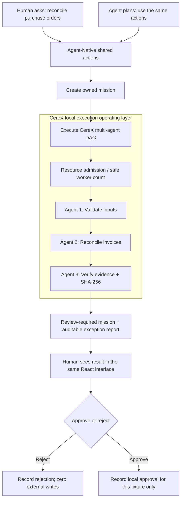

# CereX Mission Control
### The missing operating layer between **AI intent** and **work you can verify**.

**Agent-Native Hackathon 2026 · Productivity / shared human–agent workflow**  
Builder Agent-Native implementation: isolated VPS UAT. This page is a public *project brief*, **not** the complete private CereX runtime or a public deployment.

> **Text can say "done." A remote screen can show what is happening. CereX is built to turn an intended job into scheduled, inspected and auditable computer work.**

## 01 / An operational gap, not another chatbot

A product manager asks an AI assistant to reconcile purchase orders and supplier invoices. A text-only model can propose formulas. An ordinary MCP tool can expose a `reconcile` function. A remote-desktop operator can inspect a screen. None of these mechanisms, *by themselves*, specifies **who executes each dependent step, what the local PC can afford to run, how the outcome is checked, or when a human must take over**.

CereX provides that **execution operating layer**. It is complementary to foundation models, remote-computer interfaces and MCP. It is not a claim that those technologies cannot implement equivalent orchestration.

| Layer | What it answers | What it does **not** guarantee on its own |
|---|---|---|
| LLM | What should we do? | That any step actually executed |
| MCP / API | What capability can be invoked? | Scheduling, machine capacity, evidence, or independent audit |
| Remote desktop | What can an operator see or control? | Multi-worker work coordination and machine-checkable results |
| **CereX** | **What ran, on which resource budget, with what observed result and approval state?** | General intelligence, factual truth beyond the supplied checks, or unrestricted autonomy |

## 02 / One mission, two operators, one set of actions

Builder Agent-Native provides the **shared interaction contract**. CereX provides **the local execution and verification substrate**. A human and a compatible agent see the same mission state.

This is a **workflow diagram for the isolated synthetic UAT**. A general live visual-repair loop and autonomous access to real customer computers are longer-term product goals, not established by this prototype.

**Five Agent-Native `defineAction()` capabilities:** `create-mission`, `list-missions`, `execute-mission`, `review-mission` (historical fixture fallback), and `decide-mission`. The owner is checked on every mission read and mutation. `decide-mission` uses the framework's human-approval gate; the test runner confirms an unapproved CLI decision is refused.

## 03 / Observed evidence from a real execution

The demonstrator's task is narrow on purpose: **six synthetic purchase orders versus seven synthetic invoices**, checked by three dependent CereX workers. Nothing touches a real ERP, email account or bank.

| Observable outcome | Verified result | Scope |
|---|---:|---|
| Dependent CereX agents completed | **3/3** | Validator → Reconciler → Evidence auditor |
| Reconciliation findings | **8** | 2 matches; **6 exceptions** |
| Output verification | SHA-256 checked | Report/file consistency, not semantic omniscience |
| External system writes | **0** | Read-only test boundary |
| New mission duration | **1.293 s** | One measured VPS UAT run, not a latency SLA |
| Synthetic CLI + MCP tests | **11/11 passing** | Prior public OfficeOps demonstrator |

The exceptions include duplicate invoices, unknown POs, missing invoices and quantity/price mismatches. A user can trace a finding to its source record and choose to reject the result.

### Parallel-execution *microbenchmark*, not a model shootout

In a separate controlled experiment, **five independent synthetic 0.8-second jobs + one dependent auditor** ran three times:

| Measurement | Median |
|---|---:|
| Serial local CLI execution | **4.745 s** |
| CereX resource-controlled DAG | **2.997 s** |
| Ratio of these medians | **1.58×** |

*Method:* injected approximately 1.5 GiB free RAM, max three workers, fixture-only work, three repeats. **This does not compare GPT, MCP, remote desktop, OpenClaw, cloud inference, or production financial processing.** Parallel schedulers in other systems can produce similar results. CereX's added value is bringing resource policy, dependency sequencing and evidence gates into one local-agent runtime.

## 04 / Why this is useful to product managers and developers

The **product manager** gets an inspectable deliverable instead of a confident-looking answer: exceptions, proof of processing, and a clear handoff when approval is required.

The **developer** gets typed shared actions, deterministic task boundaries, isolated workspaces and a stateful timeline. A mission can be tested without granting an AI broad shell permissions or accepting a model's declaration that it finished.

The **operator** sees the work in one interface and can refuse it. In the observed UAT, the refusal changed *only* the local mission state.

## 05 / What was built during the hackathon

**Pre-existing before October 27, 2026:** the CereX concept, orchestration primitives, scheduler and local computer-agent research.

**Hackathon contribution:** a new Builder Agent-Native mission application; five typed shared actions; owner-scoped PGlite mission records; direct `execute-mission` bridge to an isolated CereX three-agent fixture; React mission timeline; evidence fingerprint readout; permission-aware review and decision flow; browser and CLI acceptance tests.

**Open-source elements already public:** [CereX OfficeOps fixture and MCP demonstrator](../cerex-officeops-2026/README.md), with [a narrated offline UAT video](../cerex-officeops-2026/assets/CereX_OfficeOps_Narrated_UAT_20261105.mp4). These are background evidence from a different competition, **not** the required Builder Clips demonstration.

**Not yet verified:** a public hosted Agent-Native deployment with persistent database, a publicly viewable Builder Clips recording, independent end-to-end live model control, and this competition's final form submission. The application is currently local-UAT only.

## 06 / 120-second judge walkthrough — recording plan

1. **0:00–0:20 | The gap.** Ask for an auditable invoice reconciliation. Explain why a fluent response alone is not proof.
2. **0:20–0:40 | Shared action.** Create the mission through the React UI; show that the state is shared with the Agent-Native action layer.
3. **0:40–1:10 | Actual local work.** Run three CereX agents in the isolated UAT, observe resource admission and wait for `review_required`.
4. **1:10–1:40 | Evidence.** Inspect the six exceptions, completion states and report fingerprint.
5. **1:40–2:00 | Human control.** Reject/approve **only the synthetic mission** and show an independent readback. Finish with the bounded claim: no external financial changes occurred.

Record this *only after* the GUI flow is independently re-verified. Do not splice a generated imitation of a Builder UI run.

## Submission readiness and links

- [Builder official hackathon rules](https://www.builder.io/hackathon/rules)
- [Agent-Native human approval documentation](https://www.agent-native.com/docs/actions-access-control/)
- [Public, reproducible OfficeOps fixture](../cerex-officeops-2026/README.md)
- **Required public Builder Clips URL:** pending
- **Official Builder submission confirmation:** pending

*This description preserves the difference between measured behaviors, prototype implementation and intended roadmap. It contains no production CereX source code, customer records, API keys or personal device credentials.*
